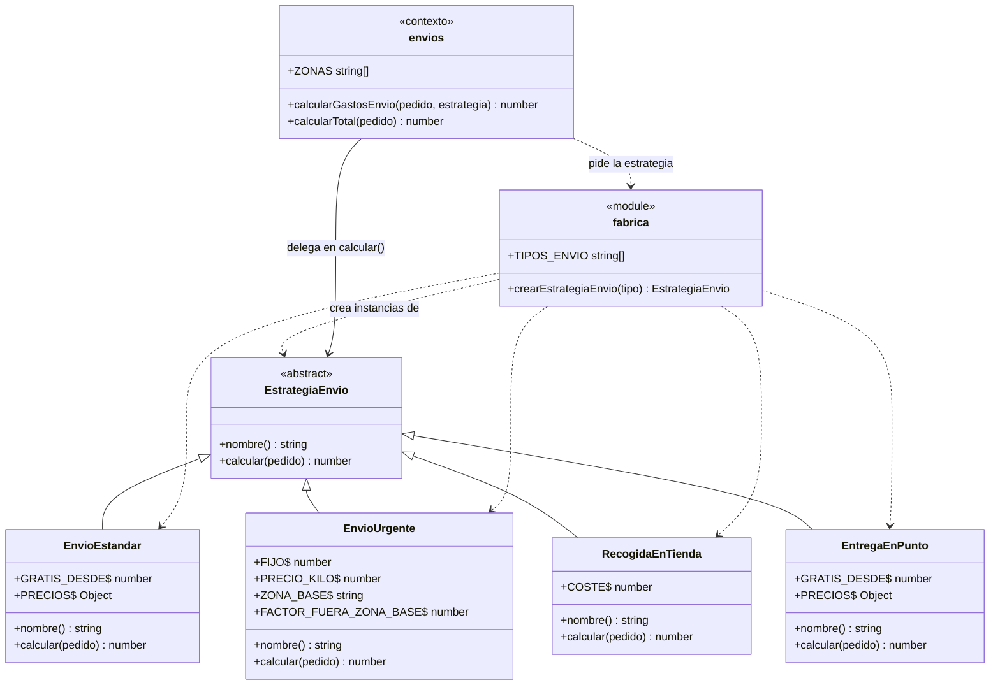
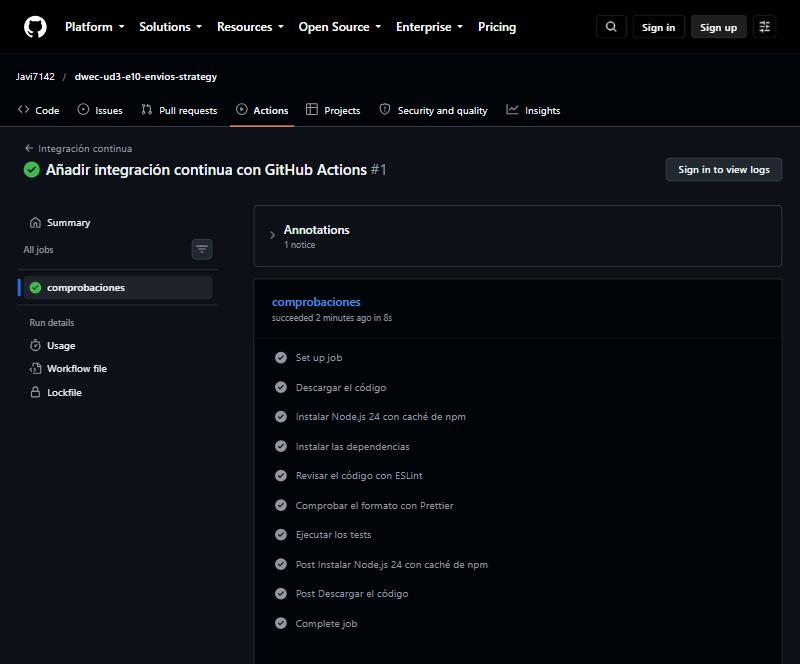
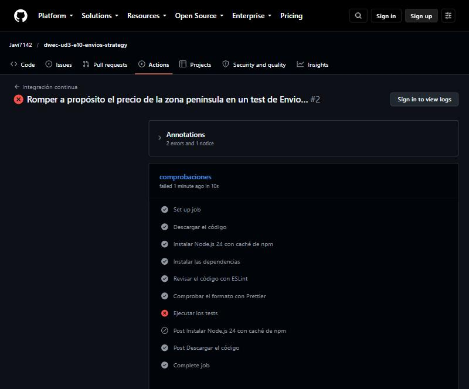

# Gastos de envío con Strategy y Factory

Repositorio del ejercicio: <https://github.com/Javi7142/dwec-ud3-e10-envios-strategy>

Salida final de `npm start`:

```text
🚚 Tipos de envío: estandar, urgente, recogida, punto
#1 Estándar           peninsula envío   4.95 € · total   39.95 €
#2 Estándar           canarias  envío   0.00 € · total   60.00 €
#3 Urgente            peninsula envío  14.15 € · total   94.15 €
#4 Urgente            baleares  envío  22.30 € · total   42.30 €
#5 Recogida en tienda canarias  envío   0.00 € · total   15.00 €
#6 Punto de recogida  peninsula envío   2.95 € · total   27.95 €
#7 Punto de recogida  baleares  envío   0.00 € · total   30.00 €
#8 ❌ Tipo de envío desconocido: dron
⚖️ El mismo pedido con cada tipo de envío:
   Estándar           9.95 €
   Urgente            29.50 €
   Recogida en tienda 0.00 €
   Punto de recogida  0.00 €
```

## El problema del código original

`calcularGastosEnvio` mezclaba en una sola función las reglas de todos los tipos de envío con un `switch (pedido.tipoEnvio)` (línea 31 del original):

- Las reglas del envío estándar (líneas 32-36: `if (pedido.importe >= 50) return 0;`, `4.95`, `9.95`, `14.95`), las del urgente (líneas 37-43: `9.95 + pedido.peso * 1.2` y `coste * 2` fuera de la península) y la recogida (líneas 44-45) estaban todas juntas, con cifras sueltas («números mágicos») sin nombre.
- **Para añadir un tipo de envío** (la entrega en punto de recogida, por ejemplo) había que abrir esta función, añadir un `case` nuevo antes del `default` (línea 46) y volver a probar **todos** los tipos, porque cualquier error de sintaxis o un `return` olvidado en el `case` nuevo (o un `break` que falta, con la caída «fall-through» del `switch`) puede alterar los demás tipos.
- **Riesgo:** un cambio para un tipo puede romper otro sin que se note. La función además tenía varias responsabilidades (validar la zona, decidir el tipo y calcular), y el tipo de envío aparecía solo aquí: había que acordarse de tocar este `switch` cada vez, y el programa principal (`main.js`) no tenía forma de saber qué tipos existían. Incumple el principio abierto/cerrado: el código debería estar abierto a nuevas variantes y cerrado a modificaciones.

## Patrones aplicados

**1. Piezas de cada patrón.**

| Patrón | Pieza | En el proyecto |
|--------|-------|----------------|
| **Strategy** | Estrategia (interfaz común) | `EstrategiaEnvio` (`src/estrategias.js`): define el getter `nombre` y el método `calcular(pedido)` |
| | Estrategias concretas | `EnvioEstandar`, `EnvioUrgente`, `RecogidaEnTienda` y `EntregaEnPunto`: cada una con las reglas de un tipo |
| | Contexto | `calcularGastosEnvio` (`src/envios.js`): valida la zona y delega en la estrategia, sin saber de cuál se trata |
| **Factory** | Fábrica | `crearEstrategiaEnvio(tipo)` (`src/fabrica.js`): único punto donde se hace `new` de una estrategia |
| | Registro | `REGISTRO` (un `Map` tipo → clase) de donde sale también `TIPOS_ENVIO` |

**2. Características de la orientación a objetos de JavaScript que aprovecho.**

- **Herencia:** las cuatro estrategias `extends EstrategiaEnvio`.
- **Sobrescritura:** cada subclase redefine el getter `nombre` y el método `calcular` de la superclase.
- **Polimorfismo:** `calcularGastosEnvio` y `main.js` llaman a `estrategia.calcular(pedido)` y `estrategia.nombre` sin saber qué clase es; cada objeto ejecuta su versión. El bucle de «El mismo pedido con cada tipo de envío» (`main.js`) lo muestra.
- **Miembros estáticos:** las cifras de cada regla son campos estáticos de su clase (`EnvioEstandar.GRATIS_DESDE`, `EnvioEstandar.PRECIOS`, `EnvioUrgente.FIJO`, `EnvioUrgente.PRECIO_KILO`, `EntregaEnPunto.GRATIS_DESDE`…), en lugar de números sueltos.
- **_Getters_:** `nombre` es un _getter_, no un campo.
- **Closures y `Map`:** el registro de la fábrica es un `Map` que no se exporta.

**3. Por qué `EstrategiaEnvio` lanza un error en lugar de devolver 0.** JavaScript no tiene interfaces ni clases abstractas, así que el único modo de «obligar» a las subclases a cumplir el contrato es lanzar un error en la superclase. Si devolviera 0, una subclase que se olvidara de sobrescribir `calcular` regalaría el envío **sin que nadie lo note**: es un fallo silencioso con consecuencias económicas. Con un error, el fallo salta en cuanto se usa y el mensaje dice qué clase lo ha incumplido (`SinCalcular debe sobrescribir calcular(pedido)`). Los tests lo comprueban.

## Diagrama de clases



## Añadir un tipo de envío

Para la entrega en punto de recogida (`EntregaEnPunto`, tipo `'punto'`) he modificado **solo dos ficheros** y no he tocado el cálculo:

- `src/estrategias.js`: la clase nueva `EntregaEnPunto` (con sus cifras como campos estáticos).
- `src/fabrica.js`: una línea más en el registro (`['punto', EntregaEnPunto]`) y su importación. `TIPOS_ENVIO` se calcula a partir del registro, así que aparece solo.

**No he modificado** `src/envios.js` (el contexto) ni `src/main.js` ni `tests/envios.test.js`: el contexto solo habla con la interfaz `EstrategiaEnvio` y la fábrica le da la estrategia que toca. Lo demuestra el commit «Paso 4: añadir el tipo nuevo EntregaEnPunto sin tocar envios.js» (`git show --stat` solo lista los dos ficheros anteriores) y un test de integración que calcula el tipo `'punto'` a través de `calcularGastosEnvio`.

**Comparación con el código original:** habría hecho falta editar `calcularGastosEnvio` (un `case` nuevo con sus `if` por zona dentro del `switch` de siempre) y volver a probar los cuatro tipos, porque un error en el `case` nuevo puede estropear los demás. Con Strategy, añadir un tipo es **añadir código** (una clase) en lugar de **modificar** código que ya funcionaba, y el único cambio en código existente es una línea en el registro.

## Pruebas

**1. Salida de `npm test` ANTES de empezar a refactorizar** (los 9 tests de `envios.test.js`, con el código original; salida con `--reporter=verbose`):

```text
 RUN  v5.0.5 /w

 ✓ calcularGastosEnvio > envío estándar a peninsula por debajo de 50 €: 4.95 € 1ms
 ✓ calcularGastosEnvio > envío estándar a baleares por debajo de 50 €: 9.95 € 0ms
 ✓ calcularGastosEnvio > envío estándar a canarias por debajo de 50 €: 14.95 € 0ms
 ✓ calcularGastosEnvio > envío estándar gratis desde 50 € 0ms
 ✓ calcularGastosEnvio > envío urgente: fijo más un precio por kilo 0ms
 ✓ calcularGastosEnvio > envío urgente fuera de la península: el doble 0ms
 ✓ calcularGastosEnvio > recogida en tienda: gratis 0ms
 ✓ calcularGastosEnvio > lanza un error con un tipo de envío o una zona desconocidos 1ms
 ✓ calcularTotal > suma los productos y el envío 0ms

 Test Files  1 passed (1)
      Tests  9 passed (9)
```

**Al terminar** (los tres ficheros; `envios.test.js` sigue igual, sin tocar una línea):

```text
 RUN  v5.0.5 /w

 ✓ EstrategiaEnvio > lanza un error si una subclase no sobrescribe el getter nombre 1ms
 ✓ EstrategiaEnvio > lanza un error si una subclase no sobrescribe calcular 0ms
 ✓ EnvioEstandar > se llama «Estándar» 0ms
 ✓ EnvioEstandar > a peninsula por debajo del importe gratuito cuesta 4.95 € 0ms
 ✓ EnvioEstandar > a baleares por debajo del importe gratuito cuesta 9.95 € 0ms
 ✓ EnvioEstandar > a canarias por debajo del importe gratuito cuesta 14.95 € 0ms
 ✓ EnvioEstandar > es gratis justo en el importe mínimo (50 €) y cuesta 1 céntimo por debajo 0ms
 ✓ EnvioEstandar > es gratis aunque el importe supere el mínimo y la zona sea cara 0ms
 ✓ EnvioEstandar > lanza un error con una zona desconocida 0ms
 ✓ EnvioUrgente > se llama «Urgente» 0ms
 ✓ EnvioUrgente > con peso 0 cuesta solo el fijo 0ms
 ✓ EnvioUrgente > suma el precio por kilo al fijo en la península 0ms
 ✓ EnvioUrgente > en baleares cuesta el doble: 24.7 € 0ms
 ✓ EnvioUrgente > en canarias cuesta el doble: 24.7 € 0ms
 ✓ EnvioUrgente > no depende del importe del pedido (nunca es gratis) 0ms
 ✓ EnvioUrgente > redondea a céntimos 0ms
 ✓ RecogidaEnTienda > se llama «Recogida en tienda» 0ms
 ✓ RecogidaEnTienda > es gratis en peninsula 0ms
 ✓ RecogidaEnTienda > es gratis en baleares 0ms
 ✓ RecogidaEnTienda > es gratis en canarias 0ms
 ✓ RecogidaEnTienda > es gratis aunque el pedido pese mucho y el importe sea pequeño 0ms
 ✓ EntregaEnPunto > se llama «Punto de recogida» 0ms
 ✓ EntregaEnPunto > a peninsula por debajo del importe gratuito cuesta 2.95 € 0ms
 ✓ EntregaEnPunto > a baleares por debajo del importe gratuito cuesta 5.95 € 0ms
 ✓ EntregaEnPunto > a canarias por debajo del importe gratuito cuesta 5.95 € 0ms
 ✓ EntregaEnPunto > es gratis justo en el importe mínimo (30 €) y cuesta 1 céntimo por debajo 0ms
 ✓ EntregaEnPunto > no depende del peso del pedido 0ms
 ✓ EntregaEnPunto > lanza un error con una zona desconocida 0ms
 ✓ interfaz común de todas las estrategias > EnvioEstandar hereda de EstrategiaEnvio y tiene nombre y calcular 1ms
 ✓ interfaz común de todas las estrategias > EnvioUrgente hereda de EstrategiaEnvio y tiene nombre y calcular 0ms
 ✓ interfaz común de todas las estrategias > RecogidaEnTienda hereda de EstrategiaEnvio y tiene nombre y calcular 0ms
 ✓ interfaz común de todas las estrategias > EntregaEnPunto hereda de EstrategiaEnvio y tiene nombre y calcular 0ms
 ✓ interfaz común de todas las estrategias > EnvioEstandar devuelve un número redondeado a céntimos 0ms
 ✓ interfaz común de todas las estrategias > EnvioUrgente devuelve un número redondeado a céntimos 0ms
 ✓ interfaz común de todas las estrategias > RecogidaEnTienda devuelve un número redondeado a céntimos 0ms
 ✓ interfaz común de todas las estrategias > EntregaEnPunto devuelve un número redondeado a céntimos 1ms
 ✓ interfaz común de todas las estrategias > cada estrategia tiene un nombre distinto 0ms
 ✓ crearEstrategiaEnvio > crea una instancia de la clase que corresponde al tipo «estandar» 1ms
 ✓ crearEstrategiaEnvio > crea una instancia de la clase que corresponde al tipo «urgente» 0ms
 ✓ crearEstrategiaEnvio > crea una instancia de la clase que corresponde al tipo «recogida» 0ms
 ✓ crearEstrategiaEnvio > crea una instancia de la clase que corresponde al tipo «punto» 0ms
 ✓ crearEstrategiaEnvio > devuelve una instancia nueva en cada llamada 1ms
 ✓ crearEstrategiaEnvio > lanza un error con un tipo desconocido 1ms
 ✓ crearEstrategiaEnvio > lanza un error con el tipo constructor, que no está en el registro 0ms
 ✓ crearEstrategiaEnvio > lanza un error con el tipo toString, que no está en el registro 0ms
 ✓ crearEstrategiaEnvio > lanza un error con el tipo , que no está en el registro 0ms
 ✓ crearEstrategiaEnvio > lanza un error con el tipo undefined, que no está en el registro 0ms
 ✓ TIPOS_ENVIO > lista los tipos disponibles en el orden del registro 0ms
 ✓ TIPOS_ENVIO > todos los tipos listados se pueden crear 0ms
 ✓ integración: calcularGastosEnvio con estrategias de la fábrica > calcula el tipo nuevo «punto» sin que envios.js lo conozca 0ms
 ✓ integración: calcularGastosEnvio con estrategias de la fábrica > el envío en punto es gratis justo desde 30 € 0ms
 ✓ integración: calcularGastosEnvio con estrategias de la fábrica > usa la estrategia que se le pasa en lugar de la del tipo del pedido 0ms
 ✓ integración: calcularGastosEnvio con estrategias de la fábrica > calcula el total con el tipo nuevo 0ms
 ✓ integración: calcularGastosEnvio con estrategias de la fábrica > valida la zona antes de usar la estrategia 0ms
 ✓ integración: calcularGastosEnvio con estrategias de la fábrica > lanza el error de la fábrica con un tipo desconocido 0ms
 ✓ calcularGastosEnvio > envío estándar a peninsula por debajo de 50 €: 4.95 € 1ms
 ✓ calcularGastosEnvio > envío estándar a baleares por debajo de 50 €: 9.95 € 0ms
 ✓ calcularGastosEnvio > envío estándar a canarias por debajo de 50 €: 14.95 € 0ms
 ✓ calcularGastosEnvio > envío estándar gratis desde 50 € 0ms
 ✓ calcularGastosEnvio > envío urgente: fijo más un precio por kilo 0ms
 ✓ calcularGastosEnvio > envío urgente fuera de la península: el doble 0ms
 ✓ calcularGastosEnvio > recogida en tienda: gratis 0ms
 ✓ calcularGastosEnvio > lanza un error con un tipo de envío o una zona desconocidos 1ms
 ✓ calcularTotal > suma los productos y el envío 0ms

 Test Files  3 passed (3)
      Tests  64 passed (64)
```

**2. Casos límite probados en cada estrategia.**

- `EnvioEstandar`: importe justo en el mínimo gratuito (50 €: gratis) y 49,99 € (4,95 €); importe muy alto con zona cara (gratis); las tres zonas; zona desconocida (error).
- `EnvioUrgente`: peso 0 (solo el fijo, 9,95 €); peso con decimales (3,5 kg: redondeo de coma flotante a 14,15 €); la península frente a Baleares y Canarias (el doble); un importe enorme (nunca es gratis).
- `RecogidaEnTienda`: gratis en las tres zonas, con un peso enorme y con un importe de 1 céntimo.
- `EntregaEnPunto`: importe justo en el mínimo gratuito (30 €: gratis) y 29,99 € (2,95 €); las tres zonas (2,95 € la península, 5,95 € Baleares y Canarias); el peso no influye (0 y 500 kg); zona desconocida (error).
- `EstrategiaEnvio`: una subclase sin `nombre` y otra sin `calcular` lanzan error.
- Interfaz común: las cuatro estrategias heredan de `EstrategiaEnvio`, tienen un `nombre` distinto y devuelven un número redondeado a céntimos.
- Fábrica: `toBeInstanceOf` de cada tipo, instancias nuevas en cada llamada, y `toThrow` con un tipo desconocido, vacío, `undefined` y con nombres heredados de los objetos (`constructor`, `toString`).

**3. Unitarios frente a de integración (tema 10, apartado 10.5.8).**

- **Unitarios:** `estrategias.test.js` (cada clase sola, sin la fábrica ni el contexto) y los dos primeros `describe` de `fabrica.test.js` (`crearEstrategiaEnvio` y `TIPOS_ENVIO`, que solo usan la fábrica y comprueban qué clase devuelve).
- **De integración:** el último `describe` de `fabrica.test.js` (usa el contexto `calcularGastosEnvio`, la fábrica y las estrategias reales juntos, incluido el tipo nuevo `'punto'` sin cambiar `envios.js`) y, ahora, todo `envios.test.js`.
- **Por qué `envios.test.js` ha cambiado de tipo sin cambiar ni una línea:** al empezar, `calcularGastosEnvio` contenía todo el cálculo y el test probaba **una sola función** (unitario). Después de la refactorización, esa misma función delega en la fábrica y en las estrategias, de modo que los mismos tests ejecutan, sin saberlo, **tres módulos juntos** (contexto + fábrica + estrategias): ya es una prueba de integración. Lo que se prueba (el comportamiento observable) es lo mismo; lo que cambia es cuántas piezas reales participan. Por eso son una buena red de seguridad de la refactorización: si el comportamiento no cambia, deben seguir pasando sin tocarlos.

**4. Un momento de la refactorización.** Ningún test original falló en ningún paso: los 9 de `envios.test.js` pasaron antes y después de cada commit (los pasos 1-2 no tocaban `envios.js`; en el 3, `calcularGastosEnvio` pasó a delegar y siguieron pasando). El que me dio más confianza fue `lanza un error con un tipo de envío o una zona desconocidos`, porque comprueba los dos mensajes de error exactos (`Tipo de envío desconocido: dron` y `Zona desconocida: luna`): obliga a que los errores de la fábrica y del contexto sigan siendo los del original, y a que se valide la zona antes de pedir la estrategia. Tras el paso 3, `npm start` ya funcionaba y mostraba `#6 ❌ Tipo de envío desconocido: punto` y `#7 ❌ …`: era lo esperado, porque el tipo `punto` aún no existía, y desaparecieron al añadir `EntregaEnPunto` en el paso 4. Los `describe` de las otras estrategias también me dieron confianza: los valores `12.35` (urgente a 2 kg) y `24.7` (el doble) salen de las cuentas del enunciado.

## Herramientas

```text
> e10-envios-strategy@1.0.0 lint
> eslint .


> e10-envios-strategy@1.0.0 format:check
> prettier --check .

Checking formatting...
All matched files use Prettier code style!
```

## Integración continua (opcional)

El workflow está en [`.github/workflows/ci.yml`](.github/workflows/ci.yml): un único trabajo en `ubuntu-latest` con los pasos «Descargar el código», «Instalar Node.js 24 con caché de npm», «Instalar las dependencias» (`npm ci`), «Revisar el código con ESLint», «Comprobar el formato con Prettier» y «Ejecutar los tests».

1. **Ejecución en verde:** <https://github.com/Javi7142/dwec-ud3-e10-envios-strategy/actions/runs/40567684996>
2. **Captura de la ejecución en verde con sus pasos:**

   

3. **Ejecución en rojo provocada a propósito:** <https://github.com/Javi7142/dwec-ud3-e10-envios-strategy/actions/runs/40567812774>. Cambié en `tests/estrategias.test.js` el precio esperado de la zona península del envío estándar (de `4.95` a `5.95`) y lo subí: la ejecución falló en el paso **«Ejecutar los tests»**, con los pasos anteriores (incluidos ESLint y Prettier) en verde.

   

   Después deshice el cambio (`4.95`) y la ejecución volvió a verde: <https://github.com/Javi7142/dwec-ud3-e10-envios-strategy/actions/runs/40567943155>.
